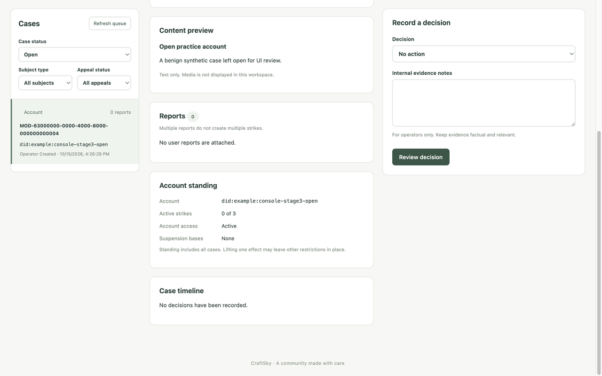

# Custom console stage 3: cases, decisions, appeals and restoration

Status: Complete and validated locally (15 October 2026)

Implements revised stage 3 of the approved plan. The agreed test seams are the
rendered React workspace with HTTP-boundary fixtures, and the shared browser
against local AppView/PostgreSQL with benign synthetic cases. Test observable
forms, confirmations, disabled/pending controls, exact uncertain-outcome retry,
conflict recovery, committed success with failed refresh, permissions and direct
case links. Keep command payloads in memory, without browser persistence or
telemetry. The backend remains the moderation policy and enforcement authority.

Implementation followed vertical slices: queue/detail reads; decision confirmation
and guarded submission; appeal/effect/restoration controls; browser validation.
No production deployment, production data changes, commits or pushes are included.

## Delivered workflows

The CraftSky React console now has a filtered, paginated case queue and directly
linkable case review (`/admin/#/cases/MOD-…`). Review includes the captured safe
text preview, allegations, account standing, strike deadline, decision history,
active consequences, effect history, attributable timeline and paginated
provenance. Restricted/unavailable previews are explicit; media is not fetched.

Operators with `moderation.manage` can record no-action or violation decisions,
confirm an appeal, uphold/change its outcome, reverse/reapply prior effects and
explicitly restore an exact severe-suspension effect. All actions use the existing
CraftSky command APIs. Internal evidence notes and owner-visible explanations
have separate fields, confirmation entries and history sections. Read-only
operators receive review controls only; helpers cannot request the global queue.
Their assigned specialist workspace remains stage 4.

Native confirmation dialogs initially focus the cancellation button, support
Escape, restore focus and explicitly wrap Tab/Shift-Tab. Queue and home
navigation, sign-out and competing actions are disabled while reviewing,
submitting, settling or recovering an uncertain command. A pending command has
its own spinner and a synchronous duplicate-submission guard.

Each confirmed command captures its complete serialized body, case revision,
route and cryptographically generated idempotency key in memory. Transport,
timeout and uncertain server outcomes retain that exact command for retry.
Conflicts retire it, refresh case data and require new review/confirmation with a
new key. A committed write remains successful if its read refresh fails; new
writes stay disabled until the case refresh succeeds. Reads discard stale queue
and case results. Requests have bounded timeouts and safe client error copy.
No command data is stored in browser storage or sent to analytics/diagnostics.

The operator case-detail API now returns the already-stored optional
`decisions[].legalClassification`. The corresponding OpenAPI schema also
documents classification and the existing owner explanation/severity fields.
Migration 98 retains private appeal-resolution rationales for either outcome and
backfills known changed-appeal explanations from effect history. Earlier upheld
rationales cannot be reconstructed; the UI says when one was not retained. Its
downgrade refuses to discard retained rationales. No route, permission, domain
policy or lexicon changed in this stage.
The classification and internal appeal rationale remain absent from owner history.

## Verification

Frontend validation passes: 15 rendered DOM/HTTP-boundary tests, strict TypeScript
checking, Vite production build and npm audit (zero vulnerabilities). The tests
cover case filtering and stale results, direct links, safe/restricted previews,
read-only/helper access, revoked access, confirmation cancellation/focus wrapping,
pending controls, exact uncertain/network retries, blocked hash navigation,
conflict re-review/new key, success with failed refresh, appeal transitions,
effect reversal/reapplication, exact-effect restoration, retained appeal rationale
and provenance cursors.
Test tooling is pinned and local to `appview/admin`; the runtime image ships only
the built assets. Tests use [React Testing Library](https://testing-library.com/docs/react-testing-library/intro/)
and [Vitest](https://vitest.dev/guide/).

The classification read test was observed failing before the readback fix and
passing afterward, including owner-history exclusion. An upheld-appeal persistence
test was also observed failing before the fix and passing afterward. Migration
tests check known-history backfill, missing-history honesty and rollback
protection. The affected moderation, route and database race suites pass. The final
`./scripts/appview-check` run exited successfully: all 49 ordinary and 49 race
package suites, Go vet/Staticcheck, generated-source checks, Docker build,
packaged media-memory checks, migrations, API smoke checks and vulnerability
scans passed. The Docker build contains the final `index-Ch-f8quX.js` bundle.
No affected-code or imported-package vulnerability was found; one required-module
vulnerability is outside the code's call paths. The pinned Tap handshake passed;
that version has no deterministic event injection API, so event injection is not
claimed. An earlier gate was stopped while reviewing the missing appeal rationale;
the final run uses the finished Go source and migration. Final log:
`/private/tmp/craftsky-case-ui-verified.log`; artifacts:
`/private/tmp/craftsky-case-ui-verified`.
The moderation OpenAPI document passes OpenAPI 3.0 validation.

The shared browser used a genuine Atmosphere operator session against this
worktree's Docker AppView/PostgreSQL. Only benign synthetic fixtures were added
using [seed-stage3.sql](../../../tools/moderation-console/seed-stage3.sql).
No operator grants, consumer OAuth credentials or production data were changed.
Development schema version 98 is clean (`dirty=false`).

| Browser action | Persisted result |
|---|---|
| Review report and decide harassment with hiding, strike and severe suspension | Resolved revision 1; one active strike; three active effects; suspended |
| Confirm appeal | Revision 2; appeal pending |
| Change appeal and reverse hiding/strike | Revision 3; appeal changed; zero strikes; severe suspension still active |
| Explicitly restore severe suspension | Revision 4; no active effects; account active |
| Reapply then reverse hiding | Revisions 5 and 6; real separate-viewer PostStore reads transition visible → hidden → visible |
| Second case: warning → confirmed appeal → uphold | Revision 3; upheld rationale stored and displayed after the real API refresh |

Each event has the signed-in operator's stable `operator:<uuid>` actor and
`craftsky-console` source. SQL confirmed the appeal, active-effect projection,
standing and visibility apply/negate records. A temporary read-only Go probe used
the real `api.NewPostStore(pool).ReadOneForViewer` against those browser-mutated
rows, checking actual post text or `ErrPostNotFound`; its source is retained at
`/private/tmp/craftsky-console-ui-postread.go`, outside the application. The
consumer HTTP route could not complete handle resolution for the deliberately
non-network synthetic DID, so consumer HTTP success is not claimed. Operator
browser commands and subsequent reads used the real cookie/CSRF API throughout.

Desktop browser layout was observed at 1402 × 877 CSS pixels. The collaborative
preview resize operation timed out with both freeform and device-preset requests,
including after reopening the preview. Responsive CSS is implemented, but a
narrow viewport browser check remains for rollout. Synthetic browser cases remain
locally for review; a third case is left open for review.

The final built bundle was reloaded in the shared preview. Browser keyboard
checks confirmed a modal dialog, Shift-Tab wrapping to confirmation, Tab wrapping
to cancellation, Escape dismissal and focus returning to the review button.
Both localStorage and sessionStorage were empty on the console origin.

Command recovery is intentionally in memory: closing/reloading the page loses
the pending key. The browser warns while a command is unresolved. After session
loss, the console instructs operators to review history before submitting a new
command. There is no automatic resend across navigation or a new login.

## Handoff

Stage 4 adds safety/intake/specialist workflows, eligibility/scan operations,
account history and operator administration. Restricted binary evidence remains
stage 5. Production configuration and rollout remain separate explicit work.
