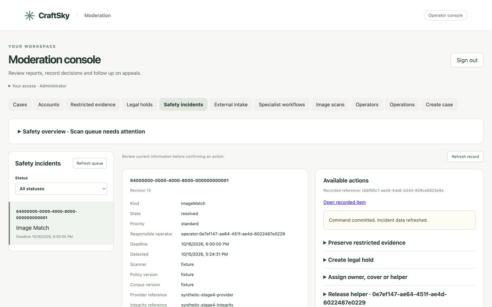
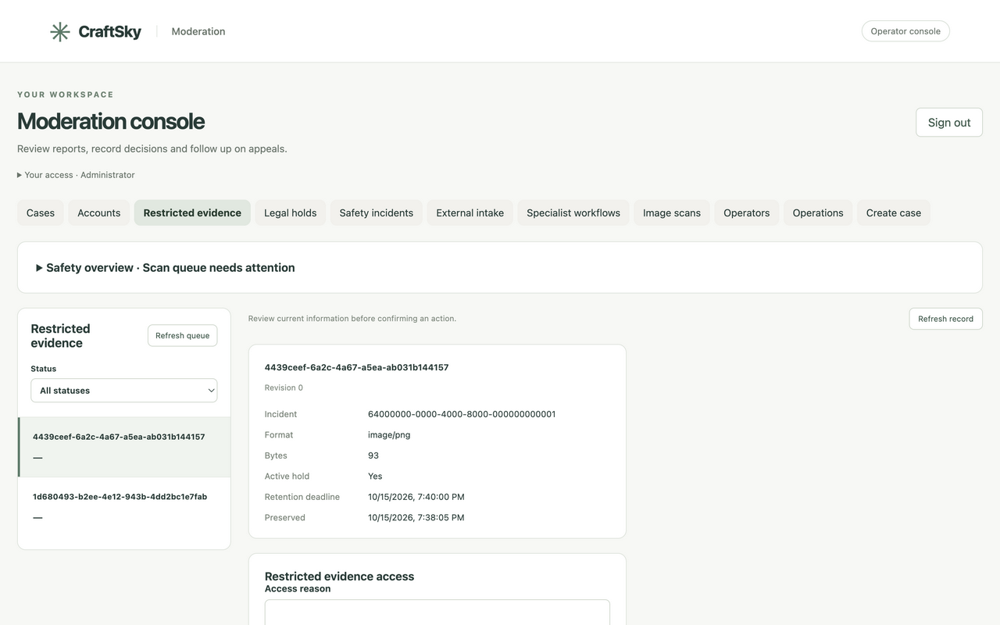

# Custom console stage 5: restricted evidence

Status: Complete locally, including the full AppView release gate. Narrow-screen
visual verification remains open for final validation.

Follow-up on 16 October: the historical proof adapter and bearer authenticator
mentioned below were removed; see the [cleanup report](10-prototype-cleanup.md).

## Delivered

The custom console now exposes restricted evidence and legal holds to admins.
Incident detail links to only its evidence and holds; global metadata lists keep
state filters and opaque pagination. Safe metadata opens without loading bytes.
New read APIs expose access attempts, hold coverage, hold contents/releases and
retention processing/events. They select explicit fields and exclude object keys,
lease data, credentials and restricted contents.

Preservation accepts a local JPEG/PNG/GIF/WebP file, reason and future retention
deadline. The browser reviews file metadata without an automatic preview. The
server checks the image signature, preserves original bytes with its digest and
returns only an evidence reference. Uploads are bounded to 512 KiB or a smaller
advertised JSON-body allowance; no resizing or recompression occurs. Larger
items need an approved procedure outside this console's current upload allowance.
The normal exact-command recovery retains an uncertain preservation submission
only in memory, with its original body, revision and key.

The viewer requires a separate reasoned confirmation. A dedicated same-origin
POST sends `{incidentReference, reason}` with the operator cookie and CSRF token.
The incident must match stored evidence. Permitted and mismatched-incident access
attempts are audited; unauthorized roles are rejected by the route boundary.
Responses use `application/octet-stream`, `Cache-Control: no-store` and `nosniff`.
Missing/deleted evidence returns 404. Binary responses do not enter replay receipts.

Only the viewer consumes the binary response. It bounds streamed bytes and
creates an in-memory image object URL. Hide, navigation/unmount, page hiding,
focus loss and disabled access clear it and revoke the URL. A second access is
disabled until the first image is hidden. Late responses after leaving the
workspace cannot display bytes or alter the next session. The CSP allows image
`blob:` URLs while keeping scripts and network requests restricted to self;
`data:` images are no longer permitted.

Hold creation selects retained evidence from the incident, requires an approved
basis and expiry, and uses the trusted administrator for creation/approval.
Release requires a fresh hold revision and a reason. Retention deadline, active
coverage, deletion metadata, access attempts, release audit, job status and
retention events are displayed separately. Existing worker deletion remains
serialized with hold creation. No new migration is required; the worktree remains
on clean migration 99 from stage 4.

The capability endpoint explains unconfigured preservation/access and publishes
size limits. It describes configured boundaries, not live provider health.
Existing metadata/hold administration remains separate from object-store access.

## Contract and maintenance changes

The access request now requires the matching `incidentReference`. This is an
intentional change to the preproduction admin API: a reason-only request is no
longer accepted. The historical synthetic Retool proof adapter/test and its
OpenAPI were aligned with this contract. Production authentication is unchanged.

Seven new GET operations are registered with exact route/access/diagnostic
inventories and the moderation OpenAPI (74 total documented operations):

- `/v1/admin/safety/evidence/capabilities`
- `/v1/admin/safety/evidence/{evidenceId}/accesses`
- `/v1/admin/safety/evidence/{evidenceId}/holds`
- `/v1/admin/safety/evidence/{evidenceId}/retention-events`
- `/v1/admin/safety/evidence/{evidenceId}/retention-jobs`
- `/v1/admin/safety/holds/{holdId}/evidence`
- `/v1/admin/safety/holds/{holdId}/releases`

Evidence reads require `evidence.access`; hold detail reads require `hold.manage`.
Preservation and hold creation retain the existing incident revision and replay
controls. Hold release retains its own revision protection. Binary access is a
separately audited read and has no replay key or binary receipt.

## Validation

Tests use the previously approved rendered UI/HTTP seam, real registered HTTP
routes with isolated migrated PostgreSQL, and the shared local T3 browser with
benign generated images. The retention service is exercised through its public
worker entry point and observed through the registered metadata/read APIs.

Observed passing checks:

- 42 frontend tests across six files, including all 34 previous tests; TypeScript
  checking and production build. `npm audit --audit-level=moderate` reported zero
  vulnerabilities.
- Preservation review/contents canaries, incident revision and safe result link;
  explicit scoped binary access and no automatic fetch; hide/background URL
  revocation; stale-response isolation; no repeat access while already open;
  unconfigured storage controls; incident-filtered pagination; hold creation and
  revisioned release with committed feedback retained.
- Affected routes, evidence, retention and operator suites on real PostgreSQL.
  HTTP checks cover image-signature/size bounds, unconfigured capabilities,
  mismatched incident audit/403, moderator/helper denials, binary integrity and
  headers, hold protection, release, worker deletion and deleted-byte 404.
- Protected metadata/object-key/payload canaries and preservation replay remain
  covered by the affected HTTP suites. The stale proof adapter test passed after
  adding the now-required incident reference.
- Both moderation and historical proof OpenAPI documents validated with
  `openapi-spec-validator`. `git diff --check` passed.
- `./scripts/appview-check` exited 0 with `all release gates passed`: all 49
  ordinary package suites and all 49 race-enabled package suites, module/codegen
  checks, formatting, vet, Staticcheck, source/binary vulnerability scans, Docker
  builds, migration-failure safeguards, health/Tap handshake and media-memory
  checks. Vulnerability scans reported zero affected vulnerabilities; one
  module-level advisory was outside imported/called code. The pinned Tap
  handshake passed; deterministic event injection remains outside this gate.

The first full release gate found the historical proof fixture still using the
old access body. The focused reproduction and corrected fixture passed. The
final gate was restarted with frozen Go source and passed on 15 October 2026.
Final log: `/private/tmp/craftsky-stage5-verified.log`; artifacts:
`/private/tmp/craftsky-stage5-verified`. Focused logs:
`/private/tmp/craftsky-stage5-http.log`,
`/private/tmp/craftsky-stage5-last-focused.log` and
`/private/tmp/craftsky-stage5-ui.log`.

## Shared browser evidence

The approved Atmosphere account renewed identity-only consent and used real
operator cookie/CSRF requests against this worktree's Docker AppView and private
MinIO store. Each generated fixture was a benign 2 by 2 PNG (93 bytes). The file
input was supplied through browser `File`/`DataTransfer` because T3 has no file
upload control. Native form validation and the actual React submission then ran.
Only metadata and assertion results were emitted by tools, never image contents,
base64, private object keys, CSRF values or cookies.

| Flow | Observed result |
|---|---|
| Preserve | Incident revision advanced; evidence metadata recorded PNG/93 bytes and the signed-in actor; no image loaded automatically |
| Access | Explicit confirmation fetched from AppView; native image decoded at 2 by 2 pixels under the real CSP |
| Hide | Image disappeared and the page reported `Evidence hidden`; repeat access was disabled while the image was open |
| Incident mismatch | Correct evidence with a different incident returned 403; denied attempt was retained in the access audit |
| Moderator boundary | Temporary local role change produced 403 for both evidence metadata and binary access; administrator access was immediately restored |
| Hold/release | Trusted actor recorded creation/approval; metadata changed to held; release revision 1 and reason audit persisted; coverage changed to unheld |
| Retention protection | A second short-lived fixture remained retained and held more than a minute after its deadline |
| Running worker | Releasing that hold allowed the normal minute-poll worker to delete the object; metadata showed deleted/revision 1, a `deleted` event and a completed job after one attempt |
| Deleted access | Matching-incident POST returned 404; the viewer explained deletion and offered no image access |

The first benign fixture remains retained until its selected deadline. Both
walkthrough holds are released; the short-lived fixture is deleted. Real
allowlisted administrator roles were restored. No restricted real-world content,
external authority transmission, production configuration, grants, deployment,
commit or push was performed.

Desktop screenshots were captured only with no evidence images in the DOM and
visually inspected. T3 resize still timed out and did not change the measured
viewport; a narrow-screen visual check remains unverified. Browser interactions
used DOM events within the shared T3 preview because its native pointer controls
were unreliable in the prior stage. Focus/cleanup and delayed-response behavior
also have component tests. jsdom's native file validator does not see user-event's
FileList shim, so that component test submits the public form event; the real
browser file/form path was checked separately.

Final validation and rollout preparation are the next stage. Production changes
still require the existing explicit authorization and exact-tag release controls.
