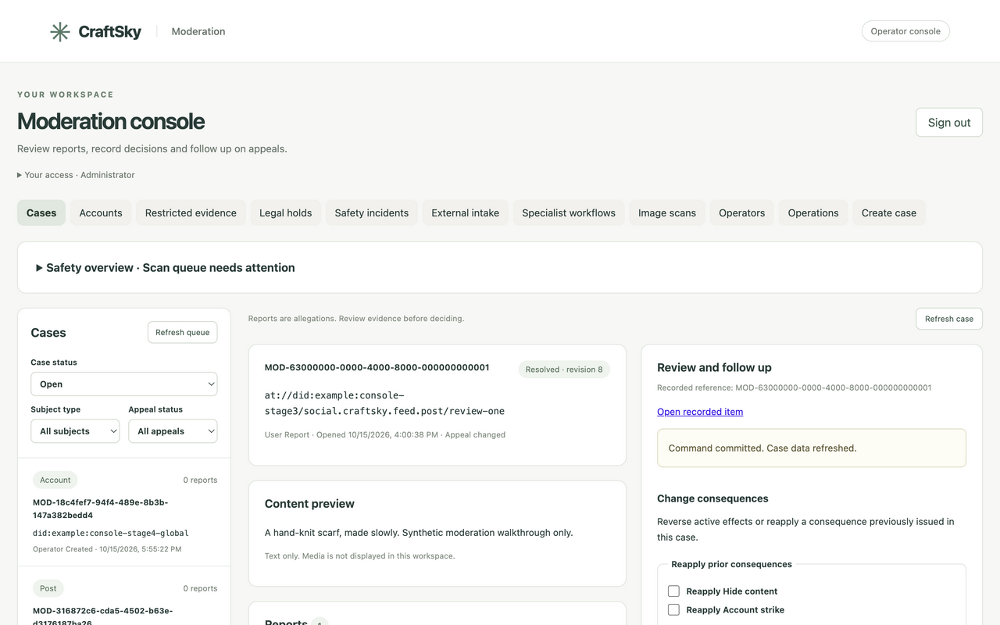
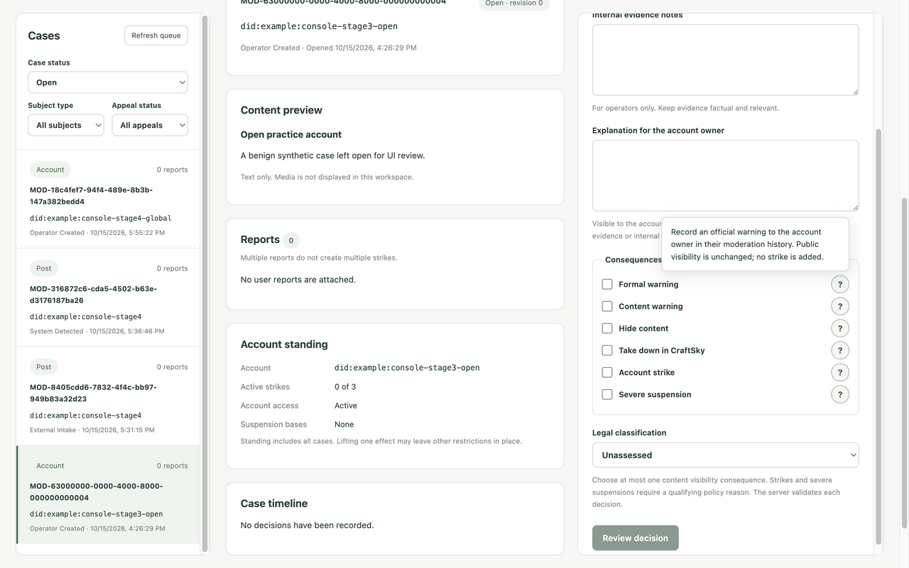

# Custom console stage 6: final validation and rollout preparation

Status: Local validation and rollout preparation complete with the verification
limits below. Production rollout and narrow-screen visual acceptance remain open.
Date: 15 October 2026.

## Changes in this stage

The release Docker build now runs `npm test` before the existing TypeScript/Vite
build. Its pinned Node stage passed all 42 tests across six files and produced
`index-IgZVgexg.js` and `index-xEH70sHy.css`. Runtime still contains built assets
only. No new dependency, API, permission, migration or lexicon change was needed.

The AppView release gate now enables admin routes in its isolated local smoke
container, with a synthetic source DID and no operator login. It fetches the
packaged shell and its actual referenced JavaScript/CSS, checks content types,
the shell's no-store/CSP boundary, and requires unauthenticated identity to return
401. This verifies the shipped asset paths and composition rather than only a
host build. It does not change production route enablement or provision access.

The stage 3 local seed lacked mirrored Bluesky profiles for its synthetic author
and separate viewer. That prevented the development-only handle fallback from
finishing consumer post responses. The seed now supplies those benign profiles
with `ON CONFLICT DO NOTHING`; existing decisions, cases and state are preserved.
The original 502 `identity_unavailable` reproduced before this fixture correction;
the same consumer route returned 200 afterward. Application identity behavior
was unchanged.

[Releases](../../operations/releases.md#appview-release) now includes console
tests/build/packaged checks in the exact-tag workflow. The
[operator runbook](../../operations/moderation-operators.md#production-rollout)
documents configuration review, first-admin provisioning, deployed OAuth and
workflow checks, session revocation, last-admin recovery and rollback.

## Workflow coverage

The earlier real-cookie browser walkthroughs remain recorded in
[stage 3](06-case-ui-implementation.md), [stage 4](07-specialist-ui-implementation.md)
and [stage 5](08-evidence-ui-implementation.md). Current API readback confirmed
their final persisted states on the same local Docker AppView. No real-world
restricted content or external report transmission was used.

| Planned workflow | Evidence and result |
|---|---|
| Report → decision → enforcement → appeal → reversal | Stage 3 completed the report case, changed appeal, independent severe restoration and effect changes. Current readback retains changed appeal, zero strikes and no suspension. This stage repeated real browser hide/reversal and checked actual consumer HTTP visibility, described below. |
| Incident → confirmation → case → reporting record → resolution | Stage 4 recorded human confirmation/system case, initial report, information response and resolution. Current incident is resolved, revision 13 after stage 5 evidence/hold commands. Registered route and domain tests cover stale review, trusted attribution and policy transitions. |
| External complaint → correspondence → case/workflow | Stage 4 persisted correspondence, external-intake case provenance and linked intimate-image workflow. Current workflow reads show intimate-image, credible-threat and authority workflows resolved. Registered route tests cover subject/owner matching and replay. |
| Evidence → access → hold → release → retention | Stage 5 used real cookie/CSRF and private MinIO with benign generated PNGs, including denied access, active-hold protection and actual worker deletion. Current expired evidence remains deleted, unheld, revision 1. HTTP/worker integration tests cover the complete lifecycle. |
| Eligibility restriction → review → restoration | Stage 4 browser commands and current readback show `eligible`, revision 2. Registered HTTP tests cover stale changes, replay and restoration. |
| Dead-lettered scan → retry → resulting state | Stage 4 browser retry persisted queued/revision 1 with scan version 1, confirmed again here. This fixture deliberately uses a scanner identity the running worker does not serve. `TestWorkerSurvivesRetryRestartExhaustionAndManualRetry` separately exercises retry → successful processing → clear result and projection wake-up with benign generated media and a controlled fetcher. No real scanner/provider success is claimed. |
| DID allowlist → OAuth → permitted action → disable → denial | First approved account used real identity-only provider consent and is currently admin. Stage 4 exercised synthetic operator lifecycle and assigned-helper/mod boundaries. `TestOperatorOAuthAndSessionBoundaries` covers allowlisting, callback/issuer/browser/scope checks, disablement, revocation, expiry and denied credentials through real HTTP handlers/PostgreSQL with fixture identity/provider endpoints. The second real allowlisted account has not completed its own provider walkthrough. |

## Current browser and consumer HTTP verification

The shared T3 preview retained the real signed-in operator session. It used the
unchanged final bundle against this worktree's Docker service. Only the existing
benign `MOD-63000000-0000-4000-8000-000000000001` case was changed:

1. The separate synthetic viewer fetched
   `/v1/posts/did:example:console-stage3/review-one` through the supported
   development CLI and actual consumer HTTP route: 200 with the expected scarf
   text after completing the seed's mirrored profiles.
2. The console reviewed and confirmed reapplying `visibilityHide`, using revision
   6. The case advanced to 7; the same consumer request returned 404
   `post_not_found`.
3. The console reviewed and confirmed reversal using revision 7. The case
   advanced to 8; the same request returned 200 with the same URI/text.
4. Current admin detail shows changed appeal, zero active effects, zero strikes
   and no severe/threshold suspension. No new severe suspension or strike was
   introduced by this check.

Consumer checks use the existing local development authentication seam, not an
operator cookie or a real consumer OAuth session. This closes the earlier
synthetic-fixture HTTP gap without claiming a production consumer walkthrough.

A further effect review was canceled with the keyboard without submission:
initial focus was **Back to review**, Shift-Tab wrapped to confirmation, Tab
wrapped back, Escape closed the dialog and focus returned to **Review effect
change**. Navigation and sign-out were disabled while review was open. Local and
session storage were empty. No evidence image was loaded during these checks or
the screenshot capture.

The measured desktop viewport is 1402 × 877. T3 preset resize again timed out
without changing that viewport. Narrow-screen visual acceptance is pending;
responsive CSS and component tests alone are not recorded as a mobile pass.

## Automated checks

- Pinned Docker frontend stage: 42 tests/six files, TypeScript and production
  build passed. Log: `/private/tmp/craftsky-stage6-admin-docker.log`.
- Locked frontend dependency audit: zero vulnerabilities. Log:
  `/private/tmp/craftsky-stage6-npm-audit.log`.
- OpenAPI validation: moderation 74 operations, operator login four operations,
  historical proof nine operations; all passed `openapi-spec-validator`.
  All 74 moderation operations have a capability-map row, with no missing or
  stale entries.
- Shell syntax and `git diff --check` passed.
- Final `./scripts/appview-check` exited 0 with `all release gates passed`:
  all 49 normal and all 49 race-enabled package suites, module/codegen checks,
  formatting, vet/Staticcheck, Docker build, source/binary vulnerability scans,
  migration/failure safeguards, health, packaged media-memory checks and the
  new packaged console shell/script/style/401 checks. Source/binary scans found
  zero affected/imported-package vulnerabilities; one required-module advisory
  is outside called code. Pinned Tap handshake passed; deterministic event
  injection remains unsupported by that Tap version. Log:
  `/private/tmp/craftsky-stage6-verified.log`; artifacts:
  `/private/tmp/craftsky-stage6-verified`.

Existing HTTP tests use isolated migrated PostgreSQL; frontend tests use rendered
DOM/HTTP fixtures. Source, route/access inventories, concurrency guards, exact
command recovery and protected-value checks remain within those established
seams. The successful full gate reran their normal and race suites with frozen
application source. CLI migration status confirmed `version=99 dirty=false`.

## Rollout handoff

Production workspace, deployed configuration, operator allowlisting and private
storage have not been inspected or amended in this stage. The checked-in
Blueprint still disables admin routes. The local database remains on migration
99, and both real approved DIDs remain active administrators. Local benign
walkthrough fixtures remain available; real operator roles were not changed.

Before production enablement, complete narrow-screen verification and the
runbook's production configuration/identity/permissions checks with explicitly
authorized resources. Select a reviewed intimate-image response target and
private storage procedure rather than copying synthetic development values.
The console preservation allowance remains 512 KiB; larger files require a
separately approved procedure. Authority forms record references/approvals and
do not transmit reports or data.

Review and commit the implementation through the normal repository workflow,
then release/deploy an exact verified tag only when requested. No commit, push,
tag, production mutation, infrastructure sync or deployment was performed here.

## Consequence tooltips (16 October 2026)

All six consequences now have purpose/effect help in decision, appeal and
effect-change controls, active consequences and effect history. The shared help
uses separate non-submitting buttons, opens on hover/focus or tap, exposes its
description to assistive technology, and supports Escape dismissal. Warning copy
distinguishes owner history from viewer banners; strike and severe-suspension
copy explains their separate account effects. No enforcement or API changed.

The interaction regression failed before implementation and passed afterward;
all 43 frontend tests, TypeScript/Vite build and `git diff --check` passed.
The running local development container received the built static assets without
an AppView restart. A background T3 tab verified the new bundle and all six
tooltips within the desktop viewport/action-card bounds using DOM hover events;
the screenshot was visually inspected. No checkbox was selected or command
submitted. Backend suites were not repeated for this frontend-only follow-up.
Mobile verification remains pending as requested.

