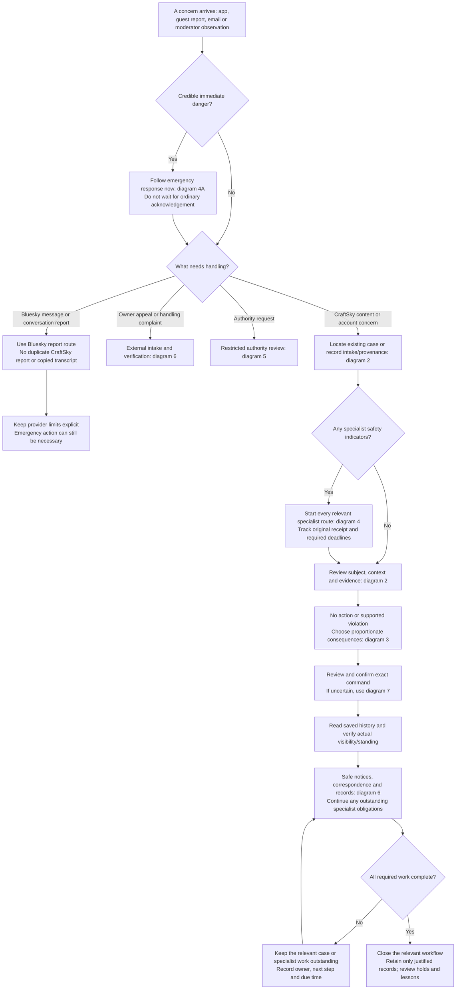
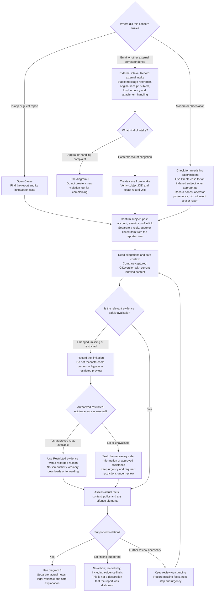
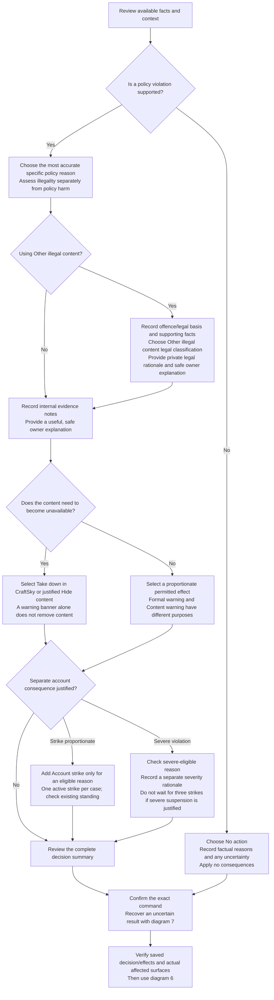
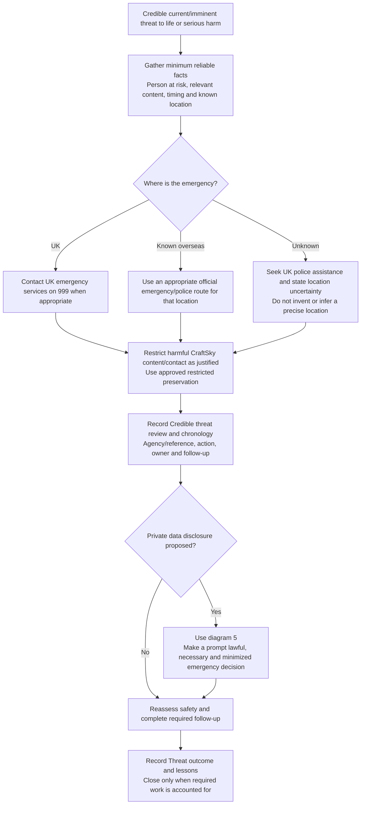
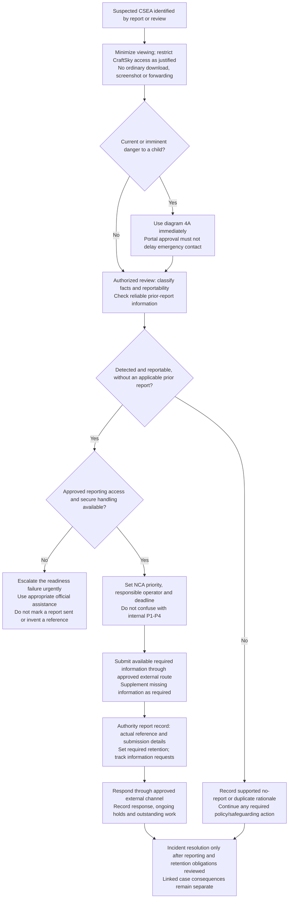
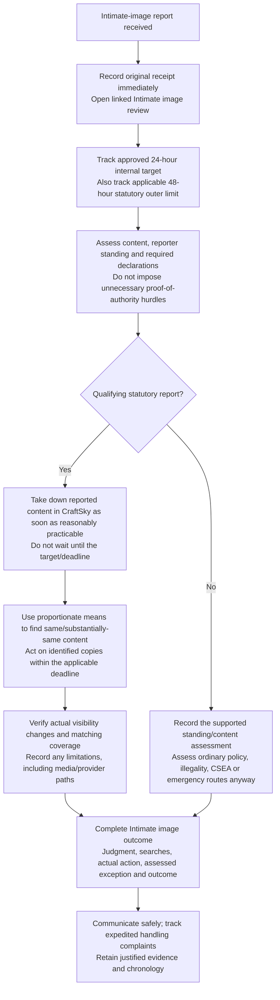
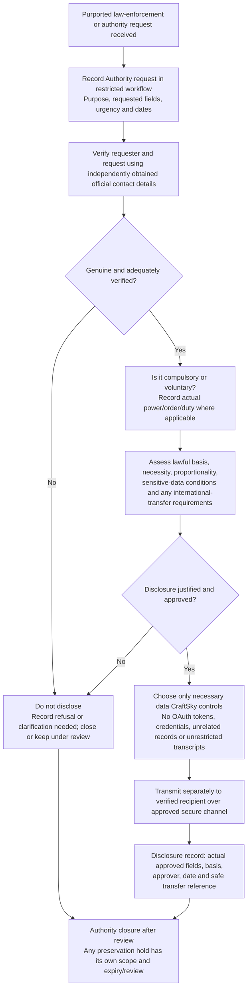
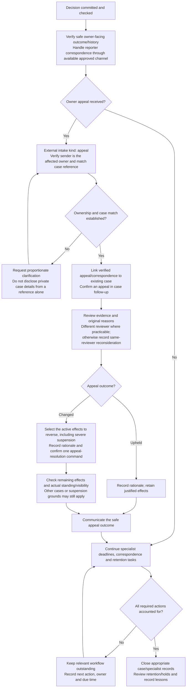
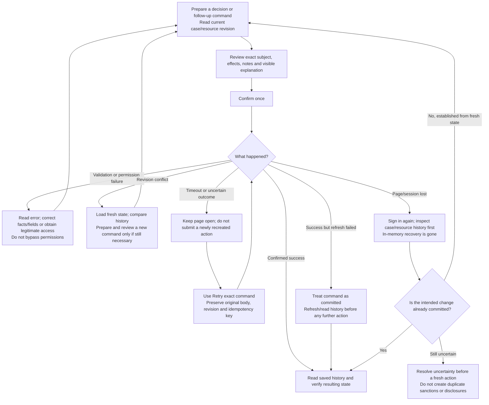

# CraftSky moderation reference: reports, decisions and follow-up

| Field | Value |
|---|---|
| Operational owner | Douglas Todd |
| Reviewed | 9 November 2026 |
| Status | Working reference to current source and recorded procedures; not final launch approval |
| Scope | CraftSky reports, external intake, moderator review, specialist escalation, appeals and recovery |

Start with diagram 1. Open the numbered detail diagram when it is referenced.
Box text describes a human task unless it explicitly says the system performs it.
A **report** is an allegation; a **case** is the review/decision record; a
**specialist workflow** records safety, reporting or authority work. These may
run together and have separate closure conditions.

This guide consolidates existing decisions rather than approving new powers.
The console does not contact emergency services, submit NCA reports, send
reporter emails or disclose information merely because a workflow form is saved.
Source changes and configuration may still await deployment; check the readiness
notes at the end before relying on them.

## 1. Overall route: receive, triage, act and follow up

**Urgency first.** Use these internal triage levels, reassessing when facts change.
These are not the NCA's separate reporting priorities.

| Internal priority | Typical indicator | What to do first |
|---|---|---|
| P1 | Immediate danger to life/serious harm; current or imminent child danger | Take the emergency route immediately; gather minimum facts and use appropriate official contacts. |
| P2 | Near-term serious harm, urgent safeguarding, suspected CSEA without P1 indicators, qualifying intimate-image report | Prioritize specialist review and restriction where supported; assign responsibility and track deadlines immediately. |
| P3 | Other suspected illegal content | Assess promptly, limit avoidable exposure and document the legal judgment. |
| P4 | Ordinary Guidelines concern | Use ordinary case review; upgrade if context shows a more serious concern. |

A report count, keyword, scanner status or risk-assessment rating does not prove a
violation or justify downgrading urgent facts. Several specialist routes can
apply to one concern. An intimate-image concern involving a child can require
both intimate-image and child-safety handling.

## 2. Intake, correct subject and evidence review

Practical intake details:

- Open the console at `https://appview.craftsky.social/admin/`. The visible tabs
  depend on permissions. Use **Cases**, **Accounts**, **External intake**,
  **Safety incidents**, **Specialist workflows**, **Restricted evidence** and
  **Legal holds** for their separate purposes.
- Use the email's Message-ID or another stable mailbox reference, not its subject
  alone. Record the **original arrival time**, including the correct timezone.
  Keep original emails in the approved mailbox; **Add correspondence** records
  subsequent message references and attachment handling rather than a transcript.
- Use the exact canonical AT URI where required, for example
  `at://<author-DID>/social.craftsky.feed.post/<record-key>`. The reported account
  DID and URI owner must match. Shared app links are normalized by the local fix;
  use the AT URI on a deployed release that still rejects the HTTPS link.
- A new case applies **no consequence**. A repeat report on a subject is context,
  not an automatic new strike. Check provenance/history before opening more work.
- Ordinary previews show safe indexed content. They do not reconstruct a captured
  version that changed, fetch restricted bytes or establish that a missing item
  never existed. Account cases without captured versions show current profiles.
- Use only enough restricted review to make the decision. Access is separately
  audited; closing/hiding the page clears the viewer. Do not preserve illegal or
  intimate material in normal case notes, email, chat, screenshots or logs.

## 3. Decide the finding and select consequences

Choose the finding from the content and conduct, not merely the reporter's chosen
category. A Guidelines breach can be actionable without a criminal finding.
When making an illegal-content judgment, record supported offence elements and
consider relevant context/defences; escalate genuine uncertainty rather than
asserting illegality to obtain a stronger sanction.

| Console consequence | What it actually does | When to consider it |
|---|---|---|
| **Formal warning** | Official notice in owner history; public visibility unchanged; no automatic strike | A supported breach needs an owner warning, with no separate removal/account penalty justified. |
| **Content warning** | Warning shown to viewers of the affected profile/post; content remains accessible; no automatic strike | Permitted content needs a warning. It is insufficient where the policy requires removal or child-access prevention. |
| **Hide content** | Makes the affected subject unavailable to other people in CraftSky | A justified visibility restriction under the applicable policy. Currently this is not a blur/reveal control. |
| **Take down in CraftSky** | Records a takedown and makes the affected subject unavailable to other people in CraftSky | A removal decision, including a supported prohibited-content finding. Use the action that accurately records the decision. |
| **Account strike** | One strike for the case; three active case strikes suspend the account; each is due to expire after one calendar year | A proportionate account consequence for an eligible supported violation. Removal or a warning alone does not add it. |
| **Severe suspension** | Suspends regardless of strike count; remains until explicitly restored | A qualifying severe violation with separate severity reasoning. It is distinct from three-strike suspension. |

Only one visibility effect may be selected in a decision. Other justified,
compatible effects may be combined. A violation decision requires factual internal
notes and at least one supported consequence. **No action** is the route when no
violation is established, rather than a violation with no consequences.

The generic **Other** reason cannot add a strike or severe suspension. **Other
illegal content** is a different, reviewed route; it requires its additional
legal fields and must never be used to relabel lawful content. Severe eligibility
in current source covers harassment, hate, adult/graphic, impersonation, child
safety, sexual violation, threat/violence, stalking/privacy, reviewed illegal
content, fraud/scam and self-harm. Eligibility is not an instruction to suspend
every case in those categories.

For fraud and self-harm, severe action requires supported serious wrongdoing:
ordinary transaction disputes, distress, illness, recovery and help-seeking are
not enough. The approved harmful-to-children boundary applies to all users of
child-accessible parts, while ordinary craft instructions and neutral garment
fit/size discussion remain welcome. Artistic/educational context is relevant,
but not a blanket exemption from a harmful-content definition.

**Scope of enforcement:** these moderation actions control CraftSky presentation
and participation. They do not delete the owner's PDS records or guarantee that
independent services, known media URLs or provider messages become inaccessible.
Verify public/guest/member detail, discovery/search, linked previews and relevant
media paths separately. Record anything that remains accessible and escalate the
control gap; saving an outcome code is not proof of removal.

## 4. Specialist safety routes

Run all applicable branches alongside necessary CraftSky moderation. Keep
responsibility, original receipt/detection time, next action and due time visible.
These diagrams summarize the linked restricted runbook; they do not replace the
case-specific assessment or authority submission requirements.

### 4A. Immediate danger and credible threats

Do not wait for NCA registration, a completed ordinary investigation or a routine
acknowledgement before seeking emergency help. Never call emergency services for
a test. Recording a threat outcome does not itself contact an authority.

### 4B. Suspected child sexual exploitation or abuse

| NCA reporting priority | Timing in the response runbook | Console classification label |
|---|---|---|
| Priority 1 | Immediately | `immediate` |
| Priority 2 | As soon as reasonably practicable | `urgent` |
| Priority 3 | Without undue delay | `standard` |

Apply the actual NCA criteria rather than mechanically translating internal
triage. The console requires a reporting deadline; do not choose an arbitrary
future time that postpones the applicable standard. Do not delay an initial
report solely to obtain every possible field. A previous report elsewhere must
be assessed under the applicable duplicate-report rules, not guessed from the
number of CraftSky reports.

Use the restricted runbook for statutory record classes: NCA unique report
reference, required retained content/information/associated-user data and any
applicable hold. Its recorded periods distinguish five-year reference retention
from one-year required material retention from the report date, including
relevant associated-user data from the two-week period before the content was
uploaded, created, shared or received, rather than an assumed two weeks before
the report. NCA information requests must
be handled as soon as reasonably practicable and no later than seven days under
the recorded procedure. Do not dump unrelated account data or credentials into a
report. Do not treat a mailbox attachment as an approved evidence store.

**Current readiness:** NCA registration is recorded as submitted, awaiting
approval; portal readiness and restricted evidence connection are not verified.
This branch is a procedure reference, not a claim those prerequisites work.
Bluesky-only DM reporting remains unchanged; a concern learned through messaging
may still need emergency/legal escalation, and unresolved provider/duty
boundaries must not be dismissed simply because a provider report was sent.

### 4C. Intimate-image abuse

The original receipt clock does not restart when the console review is opened,
when a duplicate arrives or when you become available. Linked intake supplies its
saved receipt time; enter the true original time for an unlinked review. An old
item may already be overdue. The internal 24-hour target does not extend a legal
deadline. A failed or unconfigured workflow form must not postpone protective
action; record the problem and escalate it.

The statutory branch has narrow content/standing conditions; a failed standing
check does not establish that the content is permissible. Use the runbook for the
specific assessment and expedited complaint requirements. Outcome/search fields
record the work; they do not search for matching material or apply a takedown.

## 5. Authority requests and disclosures

An authentic police request is not automatically a compulsory demand. A purported
emergency is not blanket permission to export private information. Immediate
emergency contact can proceed promptly while the necessary disclosure decision
is made and recorded. A crime-prevention exemption alone is not the lawful basis.
The console's **Disclosure record** records an approved disclosure; it is not a
secure-transfer tool. If a provider alone holds the requested data, explain
CraftSky's actual access/control rather than pretending it is available locally.

## 6. Communication, appeals, restoration and closure

Communication and timing:

| Task | Operational reference |
|---|---|
| Ordinary email acknowledgement | Approved target: within five UK business days, with a safe reference. Urgent action takes priority. This is manual; the mailbox is not automatically ingested. |
| Routine report decision | Native/web receipt copy gives an aim of ten UK business days from receipt. Complexity can affect handling; urgent/specialist/legal duties take priority. Receipt/support UI is not a completed review or a final-outcome message. |
| Reporter outcome | Where an appropriate contact route exists, communicate a safe handling outcome. Do not reveal private sanctions/evidence or another person's account details. Record whether contact was possible and any applicable communication preference. |
| Affected owner's notice | Verify owner-safe explanation/history and the available notice path. Do not put reporter identity, raw evidence, private legal rationale or authority routing in it. |
| Appeal window | Working Reporting Policy: normally within 30 calendar days of notice; good reasons for late appeals can be considered. This is a policy window, not an automatic legal-right cutoff. |
| Appeal/handling-complaint acknowledgement | Working policy aims for five UK business days; acknowledge and review without undue delay. No fixed universal final appeal deadline is implemented. Qualifying intimate-image complaints require expedited treatment. |

Appeal email does not change enforcement. Existing consequences remain while a
confirmed appeal is reviewed. One appeal lifecycle is stored per case; later
correspondence can still be considered and any later effect change must be
audited. **Effect change** and **Restore account** are distinct follow-up actions
with their own confirmation/rationale; use the supported action for the intended
change. Reversing a strike, restoring a severe suspension or lifting one case's
restriction does not automatically clear every other active restriction.

**Severe-only appeal resolution — fixed locally:** for a pending appeal, choose
**Change the decision**, select **Severe suspension** under **Effects to reverse
on appeal**, enter the appeal rationale, review and confirm. The existing appeal
command reverses that case's selected effect and resolves the appeal together.
Unselected consequences, other cases' severe suspensions and an independent
three-strike suspension remain in force. Do not run a separate restoration first
for this appeal flow. The standalone **Restore a severe suspension** action remains
available for justified restoration outside appeal resolution. Deployment and the
hosted operator check are still pending; see the [fix validation](../changes/2026-11-09-severe-only-appeal/validation.md).

A complaint about CraftSky's handling can be recorded as intake kind **complaint**
and investigated without treating the complainant as a violator. Verify the
right requester before accessing private case details. A data-protection rights
request or privacy complaint also needs the privacy procedure/contact at
`support@craftsky.social`, with its separately applicable requirements; do not
close it merely because moderation correspondence is resolved. Copyright/trade-
mark notices require the separate [IP procedure](../../online-safety/policies/copyright-and-trade-marks.md).

There is no reporter-status/history dashboard, automatic reporter-resolution
email or guaranteed staffed 24-hour monitoring. Do not promise them. Current
remaining communication/disclosure/preference gaps are tracked in REPORT-02;
this reference does not claim those have been implemented.

## 7. Safe command confirmation and recovery

Do not run the same recovery command from another tab or invent a new key to
force it through. Restricted evidence **access** is a separate audited read:
it has no command replay key, and each new access attempt is separately recorded.
Restricted evidence **preservation** uses its supported exact-command recovery;
do not confuse the two.

## Before leaving a report or incident

Check that the record tells the next reviewer:

1. What arrived, when, about which exact subject/version, and how urgent it is.
2. What facts were established, what remains uncertain, and why the decision fits
   the actual policy/legal test.
3. Which consequences actually committed and what visibility/standing was checked.
4. Whether an authority was genuinely contacted or a disclosure/report sent,
   through which approved channel, and its safe reference.
5. Whether the owner/reporter could be contacted safely, what was communicated,
   and what appeal/complaint or specialist work remains.
6. What evidence is retained, its basis/expiry/holds, and the next owner/action/time.

Resolving a moderation case is not confirmation that a linked authority report,
information request, retention obligation or intimate-image search is complete.
Use the separate records and do not manufacture a completion code to empty a queue.

## Readiness limits and sources

This reference was checked against current source and operational records on
9 November 2026. It documents workflows; it is not a claim that all launch
controls are live or that all policies are published.

- **External intake:** ordinary mailbox/reply/intake exercise is owner-reported
  as passed. Intake remains manual. Shared-link normalization awaits deployment.
- **Urgent email:** Brevo delivery/retry code is local; production activation,
  receipt and phone notification remain unverified. Alerts are generic prompts
  to inspect queues, not automatic authority reports or deadline reminders.
- **Evidence:** dedicated S3 bucket/IAM provisioning is recorded; AppView
  connection and synthetic hold/deletion exercise are deferred until merge.
  Do not improvise another evidence store if the approved route is unavailable.
- **CSEA:** NCA application is recorded as submitted, approval/access unverified.
  Emergency contact must not wait for portal access.
- **Intimate images:** 24-hour internal target is approved/in source; live target,
  matching process and actual action exercise remain to verify.
- **Decision taxonomy:** Other illegal content and expanded severe eligibility
  require the corresponding migration/release; verify the deployed console.
- **Policies:** use the applicable published policy and reviewed legal duties;
  the approved content-boundary decision and repository drafts do not establish
  that new wording is already effective. Report that mismatch rather than claim
  the reporter/owner was already given unpublished terms.

Canonical internal references:

- [Operator runbook](moderation-operators.md), including permissions, preview
  boundaries, restricted evidence, consequences, alerts and content boundaries.
- [Restricted response runbook](../../online-safety/operations/illegal-content-response.md).
- [Mailbox readiness and manual intake](../../online-safety/operations/reporting-mailbox-readiness.md).
- [Intimate-image readiness](../../online-safety/operations/intimate-image-readiness.md).
- [Restricted evidence storage](restricted-evidence-storage.md).
- [Working Reporting, Complaints and Appeals Policy](../../online-safety/policies/reporting-complaints-and-appeals.md).
- [Working Community Guidelines](../../online-safety/policies/community-guidelines.md).
- [Launch approval and recorded decisions](../../online-safety/governance/launch-approval.md).

Source checks: [case decisions](../../appview/admin/src/cases/CaseActions.tsx),
[consequence help](../../appview/admin/src/cases/ConsequenceHelp.tsx),
[follow-up actions](../../appview/admin/src/cases/FollowUp.tsx),
[workspace actions](../../appview/admin/src/workspaces/actions.ts),
[case provenance](../../appview/internal/moderation/operator_case.go),
[decision validation](../../appview/internal/moderation/policy.go) and
[standing/expiry rules](../../appview/internal/moderation/standing.go).

Official guidance and legislation checked for this guide (public CSEA XML was
used where the web reader could not parse the XHTML):
[Ofcom CSEA reporting guidance](https://www.ofcom.org.uk/online-safety/illegal-and-harmful-content/duty-to-report-child-sexual-exploitation-and-abuse-csea-content-know-the-rules-and-how-to-comply),
[NCA portal and emergency guidance](https://www.nationalcrimeagency.gov.uk/what-we-do/crime-threats/child-sexual-abuse-and-exploitation/the-child-sexual-exploitation-abuse-industry-reporting-portal),
[CSEA Reporting Regulations 2026](https://www.legislation.gov.uk/uksi/2026/268/contents/made),
and [enacted intimate-image provisions](https://www.legislation.gov.uk/ukpga/2026/20/part/5/enacted).
The detailed statutory periods above follow the canonical restricted runbook;
this summary does not expand the reporting or disclosure authority recorded there.
